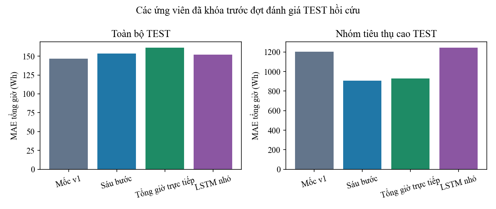
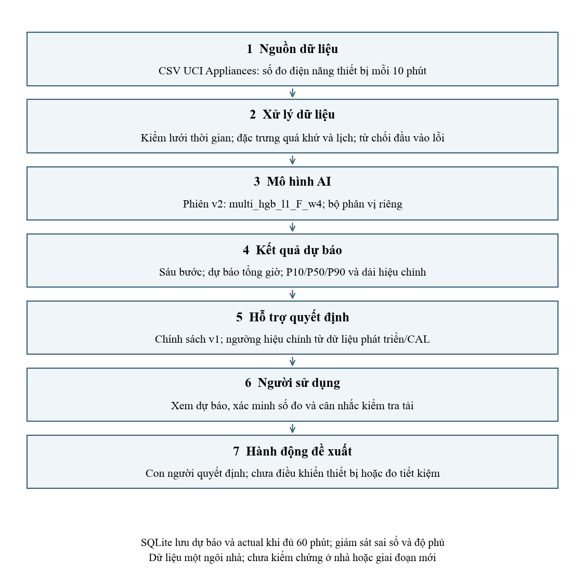
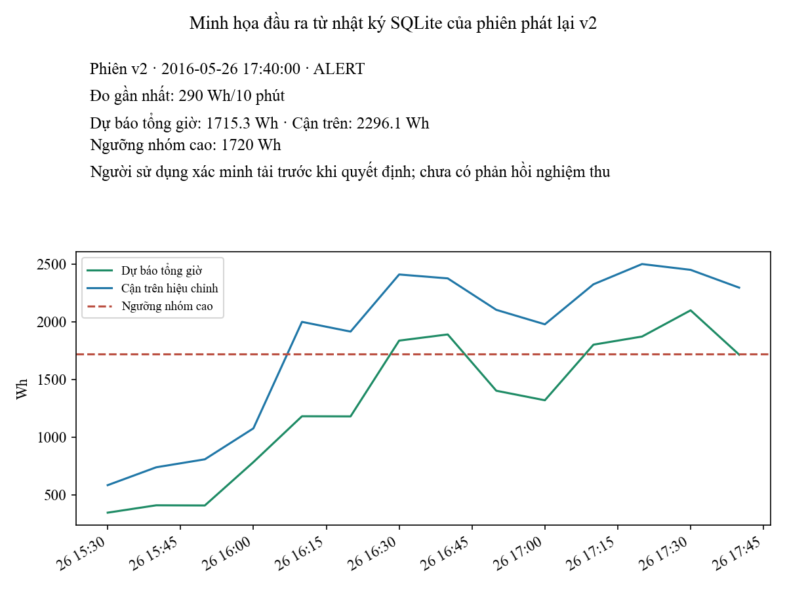

# Dự báo điện năng thiết bị trong tòa nhà

[](https://github.com/trangkhanh-ai/appliances-energy-prediction/actions/workflows/checks.yml)

Đồ án **Ứng dụng AI trong công nghiệp**, dùng **UCI Appliances Energy Prediction**.
Dự báo sáu khoảng 10 phút tiếp theo, tổng điện năng giờ tới và cảnh báo tiêu thụ cao.
Dữ liệu thuộc **một ngôi nhà năng lượng thấp tại Bỉ**, không phải khu công nghiệp.
Đơn vị mục tiêu là **Wh**; chưa đo công suất đỉnh, tiền tiết kiệm hoặc hiệu quả điều khiển thiết bị.

| Thành viên | Phần phụ trách |
|---|---|
| Nguyễn Bảo Duy | Trưởng nhóm; bài toán, dữ liệu, baseline, mô hình |
| Trang Mai Quốc Khánh | Đánh giá, phân tích lỗi, giới hạn ứng dụng |
| Lê Trần Nhật Huy | Demo, lưu trữ và giám sát |

## Kết quả chính

V2 được chọn bằng dữ liệu phát triển: **HGB-L1, 22 đặc trưng, trọng số nhóm cao 4**.
V1 giữ nguyên tại tag `v1.0.0` và `out/`; phần mới nằm trong `v2/`, `out_v2/`.
Cảnh báo vẫn dùng bộ phân vị 18 đặc trưng của v1: **P90 + margin > 1.720 Wh**.



| Chỉ số TEST hồi cứu | V1 | V2 được chọn |
|---|---:|---:|
| MAE tổng giờ (Wh) | 146,777 | 153,546 |
| RMSE tổng giờ (Wh) | 312,053 | 296,281 |
| MAE nhóm cao (Wh) | 1.201,767 | 905,608 |
| Bias dự báo − thực tế (Wh) | −86,454 | −26,910 |
| Tỷ lệ dự báo thấp nhóm cao | 98,33% | 93,33% |
| TP / FP / FN / TN | 82 / 349 / 38 / 3.378 | Giữ nguyên |

MAE nhóm cao giảm **24,64%**, RMSE giảm **5,05%**, nhưng MAE toàn bộ tăng **4,61%** so với v1.
Không đổi lựa chọn sau khi xem TEST. So với persistence, MAE của v2 giảm **24,11%**;
đây là giảm sai số, chưa phải điện tiết kiệm. Precision **19,03%**, recall **68,33%**;
độ phủ **83,31% toàn TEST**, **35,83% nhóm cao**.

## Phạm vi thực nghiệm

- 60 cấu hình cây/baseline, gồm 24 cấu hình random search; thêm một LSTM nhỏ, đều chấm trên hai fold.
- VAL trùng fold B. Ngưỡng nhóm cao chỉ lấy từ TRAIN: 1780 Wh ở A, 1720 Wh ở B.
- Bốn đặc trưng mới: diff 10/30 phút, độ lệch chuẩn 1 giờ, tỷ lệ max 1 giờ/mean 24 giờ.
- HGB-L1/L2 với trọng số 1/2/4/8; so tổng sáu bước với học trực tiếp tổng giờ.
- LSTM: 18 bước lịch sử, 24 hidden units; chọn epoch trong TRAIN có purge. Phiên đã chạy:
  PyTorch 2.11.0+cu128, RTX 5060 Laptop GPU, 30 epoch. LSTM không được chọn.
- So chính sách cảnh báo bằng ngưỡng học trên đoạn calibration và đánh giá ở đoạn thời gian sau.
- Bootstrap theo khối, phân tích lỗi/đợt cao, robustness, độ trễ và giám sát theo tuần.



## Cài môi trường

Dùng Python 3.12. Với ZIP đi kèm báo cáo, giải nén tại thư mục có README và bỏ qua clone/cd.

```powershell
git clone --config core.autocrlf=false https://github.com/trangkhanh-ai/appliances-energy-prediction.git
cd appliances-energy-prediction
py -3.12 -m venv .venv
.venv\Scripts\python -m pip install -r requirements-lock.txt
$env:PYTHONUTF8="1"
$env:OMP_NUM_THREADS="2"
$env:OPENBLAS_NUM_THREADS="2"
$env:MKL_NUM_THREADS="2"
```

Mô hình chính HGB chạy CPU, không cần GPU cho demo. Chỉ nạp joblib từ nguồn tin cậy.
Giữ byte CSV/source để mã băm khớp. Để chạy LSTM và thực thi notebook, cài thêm:

```powershell
.venv\Scripts\python -m pip install torch==2.11.0 --index-url https://download.pytorch.org/whl/cpu
.venv\Scripts\python -m pip install -r requirements-research.txt
```

Với GPU NVIDIA tương thích CUDA 12.8, thay dòng cài torch bằng:

```powershell
.venv\Scripts\python -m pip install torch==2.11.0 --index-url https://download.pytorch.org/whl/cu128
```

## Kiểm kết quả và chạy demo

```powershell
.venv\Scripts\python -m v2.check
.venv\Scripts\python -m v2.demo --out runs\demo-v2-moi
Start-Process runs\demo-v2-moi\dashboard.html
```

`v2.check` kiểm unit test, v1, model v2, notebook và demo trong thư mục tạm, không train lại.
Nếu đã cài PyTorch, dùng `python -m v2.check --include-lstm` để kiểm suy luận độc lập của toàn bộ ứng viên, kể cả LSTM.
Demo HTML tĩnh/SQLite chỉ điền actual khi đủ 60 phút đã đến. Dùng thư mục mới mỗi phiên.
Không tạo phản hồi người dùng giả hoặc gửi lệnh tới thiết bị.
Tùy chọn `--ack viewed|inspected|ignored --operator "Tên tự khai"` chỉ ghi phản hồi CLI mô phỏng,
không chứng minh người dùng đã nghiệm thu hoặc tác động lên thiết bị. Mặc định không ghi phản hồi.



## Notebook và số liệu

| Notebook đã thực thi | Nội dung |
|---|---|
| `01_du_lieu_va_tien_xu_ly.ipynb` | Dataset, đặc trưng và kiểm rò rỉ |
| `02_thuc_nghiem_va_chon_mo_hinh.ipynb` | Fold, tuning, trọng số, lựa chọn đã khóa |
| `03_ket_qua_va_demo.ipynb` | Tính lại metric từ CSV, biểu đồ và giới hạn |

Notebook đọc kết quả, không tự train lại TEST. Tạo lại bằng `python tools/build_notebooks.py`.
Đối chiếu số liệu tại `out_v2/development.json`, `selection_lock.json`, `results.json`,
`test_predictions.csv`, `supplement.json`, `performance.json`, `verification.json`.

## Tái lập toàn bộ nghiên cứu

Phiên đi kèm đã khóa TEST. Trước khi chạy lại, đổi tên `out_v2` thành tên sao lưu mới:

```powershell
Rename-Item -LiteralPath out_v2 -NewName out_v2_saved
.venv\Scripts\python -m v2.run development --include-lstm
.venv\Scripts\python -m v2.run final
.venv\Scripts\python -m v2.verify --include-lstm
.venv\Scripts\python -m v2.analysis
.venv\Scripts\python -m v2.demo
.venv\Scripts\python -m v2.plots
.venv\Scripts\python tools/build_notebooks.py
.venv\Scripts\python -m v2.check --include-lstm
```

Development không tạo nhãn CAL/TEST; final dùng cấu hình đã khóa, fit TRAIN, hiệu chỉnh CAL rồi chấm TEST.
TEST từng được xem ở v1 nên đây vẫn là đánh giá hồi cứu. GPU có thể khác số thực giữa môi trường.

## Tổ chức source

| Tệp | Vai trò |
|---|---|
| `appliances_core.py`, `run_all.py`, `ridge_scratch.py` | Lõi v1 giữ nguyên |
| `v2/core.py` | Đặc trưng, trọng số TRAIN, mô hình tổng giờ |
| `v2/run.py` | Development/final, tuning và khóa lựa chọn |
| `v2/lstm.py` | LSTM nhỏ và chọn epoch trong TRAIN |
| `v2/metrics.py` | Nhóm cao, cảnh báo, dải dự báo, bootstrap |
| `v2/runtime.py`, `v2/serve.py` | Suy luận tham chiếu và phục vụ đã bỏ tính lặp |
| `v2/verify.py`, `v2/check.py` | Đối chiếu model, nhãn, số liệu, notebook, demo |
| `v2/demo.py`, `v2/analysis.py`, `v2/plots.py` | Demo, phân tích và hình từ kết quả đã khóa |
| `test_core.py`, `test_contract.py`, `test_v2.py` | Kiểm nhân quả, purge, đầu vào/đầu ra |
| `data/`, `out/`, `out_v2/`, `notebooks/` | CSV gốc, kết quả v1/v2, notebook có output |

## Giới hạn và nguồn dữ liệu

- Một ngôi nhà, khoảng 4,5 tháng; chưa có nhà/mùa mới để kiểm ngoài mẫu.
- Giả định số đo tại t đã có. Múi giờ/độ trễ công bố chưa được xác nhận.
- 120 thời điểm cao tạo 21 cụm cửa sổ chồng lấn, không phải 120 sự kiện độc lập.
- V2 vẫn dự báo thiếu ở 93,33% thời điểm cao; dải dự báo không bảo đảm an toàn.
- FPR mục tiêu CAL không bảo đảm FPR TEST giống hệt. Báo nhầm còn nhiều.
- Chưa có tải điều khiển, biểu giá, can thiệp hoặc nghiệm thu người dùng; chưa đo tiết kiệm thực tế.

Dữ liệu: [UCI Appliances Energy Prediction](https://archive.ics.uci.edu/dataset/374/appliances-energy-prediction),
DOI `10.24432/C5VC8G`, CC BY 4.0. Nghiên cứu gốc: Candanedo, Feldheim và Deramaix (2017),
DOI `10.1016/j.enbuild.2017.01.083`. [Kho đối chiếu của tác giả](https://github.com/LuisM78/Appliances-energy-prediction-data).
Word/PDF và tài liệu nội bộ nằm ngoài gói source công khai.
