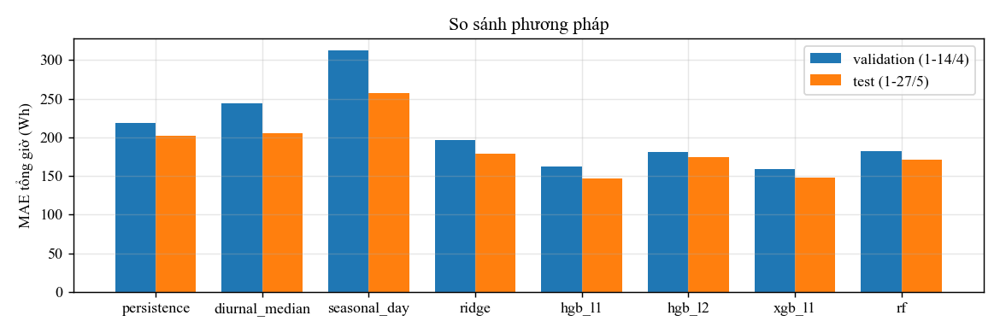
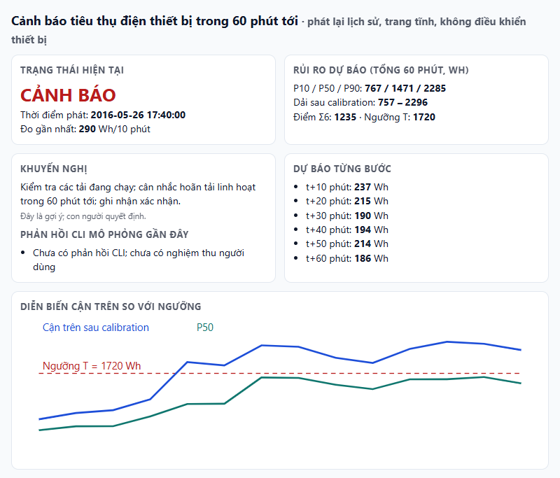
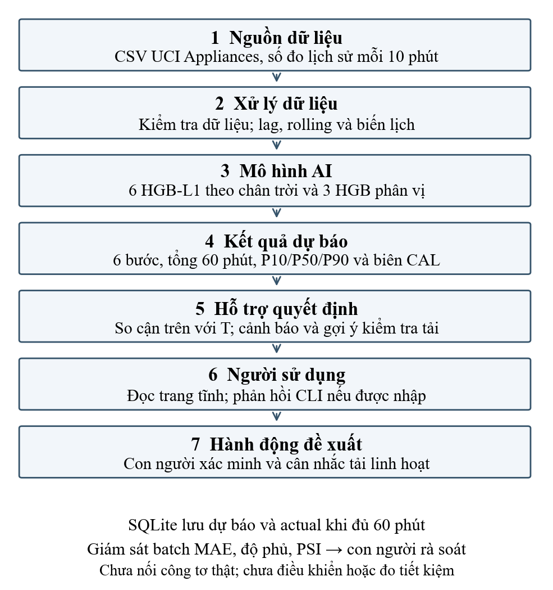

# Dự báo điện năng thiết bị trong tòa nhà với UCI Appliances

[Kiểm thử tự động](.github/workflows/checks.yml)

Đồ án học phần **Ứng dụng AI trong công nghiệp**, sử dụng bộ dữ liệu
**UCI Appliances Energy Prediction** trong danh sách đề xuất của giảng viên.

## Nhóm thực hiện

| Thành viên | Phần phụ trách |
|---|---|
| **Nguyễn Bảo Duy** | Trưởng nhóm; xác định bài toán, dữ liệu, baseline và mô hình |
| **Trang Mai Quốc Khánh** | Đánh giá, phân tích lỗi và giới hạn ứng dụng công nghiệp |
| **Lê Trần Nhật Huy** | Demo, lưu trữ dữ liệu và giám sát |

## Bài toán



Bản kiểm chứng ngày 05/11/2026, dùng UCI Appliances Energy Prediction.
Đầu vào là số đo đã có đến thời điểm t. Đầu ra gồm sáu giá trị Wh cho t+10 đến t+60,
tổng điện năng giờ tới và P10/P50/P90 của tổng giờ. Cảnh báo nếu cận trên sau
hiệu chỉnh vượt p95 TRAIN. Ngưỡng này không phải giới hạn công suất hợp đồng.

## Kết quả đã chạy

- 19.735 hàng gốc, bước 10 phút; CSV giữ nguyên và kiểm SHA-256.
- TRAIN 11.412, VALIDATION 2.010, CAL 2.298, TEST 3.847 origin hợp lệ.
- Chọn A_ar_calendar (18 biến) và HGB-L1 theo hai fold walk-forward.
- MAE tổng giờ TEST: 146,776743 Wh; persistence: 202,326488 Wh; giảm khoảng 27,46%.
- Cảnh báo: TP 82, FP 349, FN 38, TN 3.378; precision 19,03%, recall 68,33%.
- Độ phủ dải TEST 83,31%; nhóm cao chỉ 35,83%.
- 15 unit test đạt; đủ 23.082 nhãn TEST kiểm lại; 200 origin online khớp batch.

`out/results.json`, `out/test_predictions.csv`, `out/verification.json` là nguồn số liệu.
Các con số ghi trong gói Master đầu vào không được coi là kết quả đã tái lập.
Thời gian chạy phụ thuộc máy; không ép đúng thời gian tham chiếu.

## Cài môi trường

Dùng Python 3.12 trên Windows. Mở PowerShell trong thư mục này:

```powershell
py -3.12 -m venv .venv
.venv\Scripts\python -m pip install -r requirements-lock.txt
$env:OMP_NUM_THREADS="2"
$env:OPENBLAS_NUM_THREADS="2"
$env:MKL_NUM_THREADS="2"
.venv\Scripts\python -m unittest discover -v
```

## Đọc kết quả và chạy demo sẵn

```powershell
.venv\Scripts\python verify_results.py
.venv\Scripts\python demo_replay.py --steps 14
Start-Process out\demo\dashboard.html
```

Chỉ nạp `joblib` từ nguồn tin cậy. Model trong thư mục này được huấn luyện mới
bằng code đi kèm, không nạp model nhận từ gói Master tham khảo.
Demo là HTML tĩnh, không có server hoặc nút phê duyệt. Mặc định không tạo phản hồi.
`--ack` chỉ là tham số mô phỏng CLI, không chứng minh người dùng đã nghiệm thu.
SQLite chứa dự báo và chỉ điền actual khi đã tới đủ sáu phép đo tương lai.
Script tạo lại DB trong thư mục `--out`; dùng một thư mục mới để giữ phiên cũ.

## Huấn luyện lại toàn bộ

```powershell
.venv\Scripts\python run_all.py
.venv\Scripts\python monitor_check.py
.venv\Scripts\python draw_architecture.py
.venv\Scripts\python demo_replay.py --steps 14
.venv\Scripts\python verify_results.py
```

Các lệnh ghi đè kết quả trong `out/`; sao lưu thư mục trước khi muốn giữ một phiên.
Thực nghiệm chính chạy CPU, giới hạn hai luồng; không có kết quả GPU trong bản này.
Không chỉnh siêu tham số theo TEST. VALIDATION đã tham gia lựa chọn; TEST đã được
quan sát trong phát triển và dùng lại cho kiểm chứng, chưa phải bằng chứng ngoài mẫu mới.

## Các tệp chính

| Tệp | Nhiệm vụ |
|---|---|
| appliances_core.py | Đọc và kiểm dữ liệu, đặc trưng, nhãn, mô hình, metric, suy luận |
| ridge_scratch.py | Ridge đa đầu ra viết bằng NumPy, đối chiếu thư viện |
| run_all.py | Walk-forward, chọn phương án, fit, phân vị, stress test, lưu số liệu/hình |
| verify_results.py | Tính lại độc lập nhãn, dự báo, metric; bootstrap theo khối |
| test_core.py, test_contract.py | Kiểm rò rỉ, purge, đầu vào và NO_FORECAST |
| demo_replay.py | Phát lại lịch sử, SQLite và HTML tĩnh |
| monitor_check.py | MAE, độ phủ, PSI theo tuần sau khi nhãn đã đến |
| draw_architecture.py | Sơ đồ 7 thành phần, phân biệt hành động đề xuất |
| data/ | CSV gốc và mô tả biến |
| out/ | Model, số liệu, chứng cứ kiểm tra và hình đã tạo |

## Giao diện và kiến trúc



<details>
<summary>Xem luồng dữ liệu → AI → hỗ trợ quyết định</summary>



</details>

## Vì sao xử lý dữ liệu như vậy

- Không impute/cắt đỉnh trên CSV nguồn vì không có ô thiếu; đỉnh hợp lệ là đối tượng cần đánh giá.
- Lag/rolling chỉ kết thúc tại t; lịch của t+10 biết trước. 145 hàng là lịch sử tối thiểu.
- Không chia ngẫu nhiên; purge nhãn vượt biên. Scaler chỉ học phần train từng fold.
- Chỉ Ridge cần StandardScaler. Không mã hóa chung mọi cột, không dùng SMOTE cho chuỗi hồi quy.
- rv1/rv2 là biến ngẫu nhiên. Nhóm có rv1 chỉ làm đối chứng, không đủ chứng minh mức nhiễu.
- Thời tiết trạm có nội suy, chưa rõ độ trễ công bố; C–E chỉ khảo sát ngoại tuyến.
  Nhóm A cuối cùng không dùng chúng.
- Dải hiệu chỉnh chỉ có độ phủ thực nghiệm, không cam kết xác suất đúng cho mỗi giờ.

## Giới hạn cần trình bày

Precision thấp và nhóm tiêu thụ cao còn yếu. Cụm origin chồng lấp không phải
sự kiện thiết bị độc lập; lead của cụm ghép ngoại tuyến không chứng minh báo trước thiết bị bật.
Wilson dựa trên giả định độc lập chưa hoàn toàn phù hợp; bootstrap theo khối chỉ khảo sát
biến thiên trong giai đoạn đã có. Các tỷ lệ FP+r×FN là giả định, không phải tiền hoặc điện
tiết kiệm. Chưa có can thiệp thật, công tơ chuẩn, biểu giá, hoặc nghiệm thu người dùng.
Giám sát là batch ngoại tuyến; chưa kết nối thiết bị thật hay tự retrain.

## Nguồn tham khảo

- [UCI Appliances Energy Prediction](https://archive.ics.uci.edu/dataset/374/appliances+energy+prediction), DOI 10.24432/C5VC8G, CC BY 4.0.
- [Dữ liệu và code R của tác giả](https://github.com/LuisM78/Appliances-energy-prediction-data).
- Candanedo et al., Energy and Buildings, 2017, DOI 10.1016/j.enbuild.2017.01.083.
- Lee, Industrial AI, 2020, DOI 10.1007/978-981-15-2144-7, Case Study 4.
- [scikit-learn HGB](https://scikit-learn.org/1.9/modules/generated/sklearn.ensemble.HistGradientBoostingRegressor.html).
- [Conformalized Quantile Regression](https://arxiv.org/abs/1905.03222).
- Künsch, 1989, DOI 10.1214/aos/1176347265: nền tảng bootstrap cho quan sát phụ thuộc.
