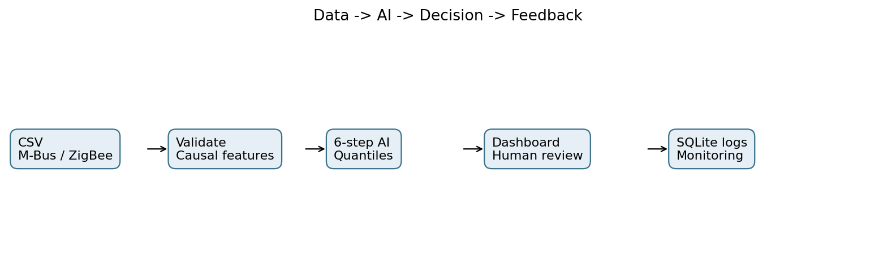
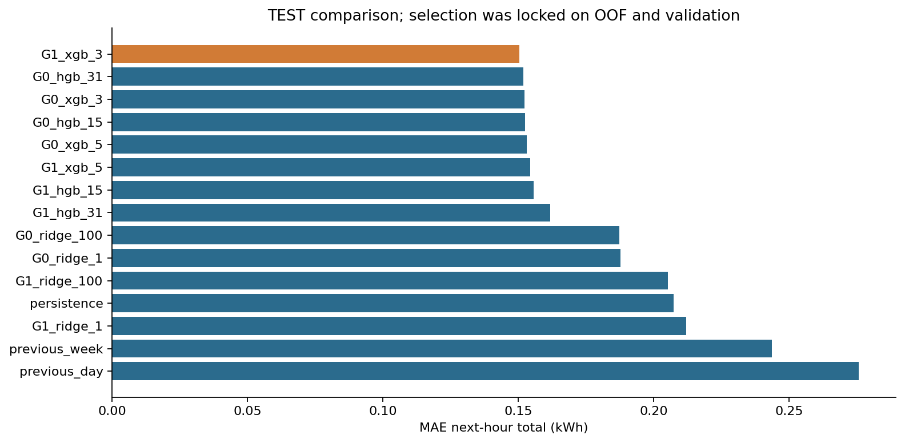
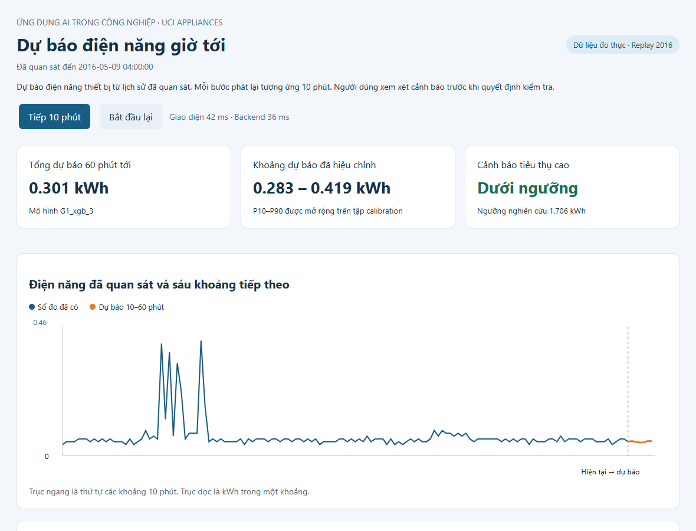
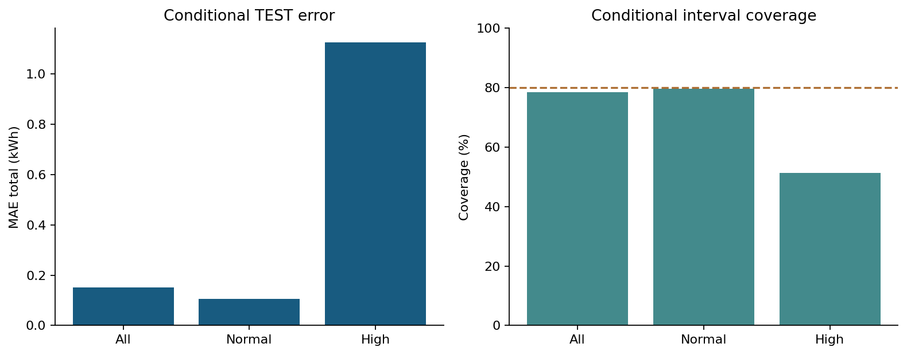

# Dự báo điện năng thiết bị với UCI Appliances

Giải pháp dự báo sáu khoảng **10–60 phút** tiếp theo và hỗ trợ người sử dụng xem xét mức tiêu thụ cao. Đồ án học phần **Ứng dụng AI trong công nghiệp**, dùng dataset tòa nhà được giảng viên gợi ý.



## Kết quả đã chạy

Phiên bản này dùng **Appliances**, thay thế nội dung Steel ở phiên bản trước. Các kết quả dưới đây được tính từ số đo nguồn, chưa đo điện hoặc tiền tiết kiệm sau can thiệp.

| Hạng mục | Kết quả TEST |
|---|---:|
| Phương án chọn bằng OOF và validation | G1 XGBoost, depth 3 |
| Đặc trưng | 38 |
| MAE mỗi khoảng 10 phút, trung bình sáu chân trời | 0,030932 kWh |
| MAE tổng giờ tới | 0,150373 kWh |
| RMSE tổng giờ tới | 0,318112 kWh |
| MAE tổng giờ ở nhóm tiêu thụ cao | 1,125947 kWh |
| Coverage khoảng dự báo toàn TEST | 78,48% |
| Coverage riêng nhóm cao | 51,28% |
| Precision / recall cảnh báo | 22,11% / 76,92% |
| TP / FP / FN / TN theo origin | 90 / 317 / 27 / 2.261 |

**Cảnh báo còn nhiều lần nhầm và nhóm cao còn yếu.** Đầu ra hỗ trợ người sử dụng kiểm tra và phản hồi. Kết quả không đủ cho tự động cắt điện hay chứng minh tiết kiệm thực tế.



## Chạy nhanh trên Windows

Dùng Python **3.14** để đọc gói mô hình trong môi trường đã kiểm nghiệm. Mở PowerShell ở thư mục chứa README.

```powershell
python -m venv .venv
.venv\Scripts\python -m pip install -r requirements-notebooks.txt
.venv\Scripts\python -X utf8 -m scripts.show_results
.venv\Scripts\python -X utf8 -m scripts.serve_demo --port 8767
```

Mở **http://127.0.0.1:8767/**. Các mô hình xuất ra dùng CPU khi suy luận. GPU chỉ cần khi chọn train với `--device cuda`.



- **Tiếp 10 phút** nhận thêm một bản đo rồi phát dự báo mới.
- **Bắt đầu lại** tạo phiên replay mới.
- Xem sáu dự báo, tổng giờ, khoảng dự báo và cảnh báo.
- Nhập tên và phản hồi để lưu nhật ký SQLite trong `outputs/`.
- Sai số chỉ được chấm khi đủ sáu số đo tương lai.

## Dữ liệu và bài toán

- Nguồn chính thức [UCI Appliances Energy Prediction](https://archive.ics.uci.edu/dataset/374/appliances+energy+prediction), DOI **10.24432/C5VC8G**, CC BY 4.0.
- CSV có 19.735 hàng, 29 cột, từ 11/01 đến 27/05/2016, cách nhau 10 phút.
- Biến cần dự báo là `Appliances`, đơn vị nguồn Wh. `energy_kWh = Appliances / 1000`.
- `lights` là trường riêng. Dự án dự báo điện năng của biến Appliances, không cộng tùy ý các trường để gọi thành toàn bộ điện năng nhà.
- Timestamp được giả định là thứ tự của bản đo đã hoàn tất. Múi giờ và quy ước đầu/cuối khoảng đo cần xác minh khi nối công tơ thật.
- Không có missing, duplicate timestamp hay khoảng gián đoạn trong bản nguồn đã kiểm.
- Thời tiết trạm được nội suy upstream, chưa xác minh tính sẵn có khi dự báo. Các cột này và `rv1/rv2` được loại khỏi feature chính.

File nguồn giữ nguyên byte với SHA256 `2820bf712ad0275cb18b85a05250926100d8e65ebb9f4d2d016ca91ea152a25d`. `prepare_data` tải lại từ UCI nếu file chưa có, rồi kiểm hash.

## Quy trình thực nghiệm

| Tập | Thời gian | Số origin dùng |
|---|---|---:|
| TRAIN | 11/01–10/04/2016 | 11.988 |
| Validation | 11–24/04/2016 | 2.010 |
| Calibration | 25/04–08/05/2016 | 2.010 |
| TEST | 09–27/05/2016 | 2.695 |

Đã loại 1.008 hàng thiếu lịch sử tuần, 6 hàng cuối thiếu nhãn và 18 origin có nhãn đi qua ba ranh giới. Thực nghiệm có ba fold mở rộng nằm trong TRAIN, không shuffle.

- **G0** có 19 feature từ lịch sử điện và lịch thời gian.
- **G1** thêm 18 cảm biến nhà cùng `lights`, trễ một khoảng hoàn tất, thành 38 feature.
- Baseline gồm persistence, ngày trước và tuần trước.
- Ridge dùng scaler fit riêng trong mỗi TRAIN/fold. HGB và XGBoost có hai cấu hình mỗi họ.
- Có 12 tổ hợp cấu hình/nhóm feature. Lấy cấu hình OOF tốt nhất từng họ/nhóm, sau đó chọn theo MAE tổng giờ validation.
- TEST được chấm sau khi khóa lựa chọn. Không thay winner dựa vào thứ hạng TEST.
- Ba HGB quantile riêng học P10/P50/P90 của tổng giờ. Calibration dùng tập CAL và score CQR-style không âm, mức danh nghĩa 80%. Chuỗi thời gian phụ thuộc nên coverage chưa có bảo đảm lý thuyết.
- Ngưỡng cảnh báo **1,7065 kWh** là p95 tổng giờ trên TRAIN, phục vụ nghiên cứu. Đây không phải công suất hợp đồng.
- Ablation trên validation và benchmark cùng cấu hình CPU/GPU được lưu riêng. Các chẩn đoán bổ sung không thay mô hình đã chọn.



## Đọc code theo thứ tự

| File | Nội dung cần hiểu |
|---|---|
| `src/appliances/config.py` | 10 phút, 6 chân trời, 1.009 bản đo lịch sử, split và fold |
| `src/appliances/data.py` | Kiểm nguồn, schema, phép đo và đổi đơn vị |
| `src/appliances/features.py` | Tạo X từ quá khứ, Y từ sáu bản đo tương lai |
| `src/appliances/modeling.py` | Fit Ridge, HGB, XGBoost và quantile |
| `src/appliances/experiment.py` | Search, chọn model, calibration và lưu kết quả |
| `src/appliances/metrics.py` | MAE, RMSE, coverage, PR và cảnh báo |
| `src/appliances/inference.py` | Đọc artifact đã kiểm hash và dự báo từ lịch sử |
| `src/appliances/demo.py` | Replay, nhãn đến muộn, SQLite và phản hồi |
| `src/appliances/verification.py` | Đối chiếu nguồn, dự báo và metric |
| `web/index.html` | Giao diện có biểu đồ, cảnh báo và thao tác người dùng |

Một hàng train gồm **X(t)** và **Y(t)**. X(t) chỉ dùng lịch sử đã quan sát, Y(t) gồm sáu bản đo tương lai để học. Khi demo, chỉ truyền X(t), còn actual được để trống cho đến khi đủ thời gian.

## Notebook đã thực thi và có output

1. `01_data_understanding.ipynb` — nguồn, audit, phân tích 3B và biểu đồ TRAIN.
2. `02_preprocessing_features.ipynb` — đơn vị, lag/rolling, split và phép tính bằng số đo thật.
3. `03_models_tuning.ipynb` — fit Ridge thật, kiểm khớp kết quả, full search, ablation và GPU.
4. `04_evaluation_error_analysis.ipynb` — ba mức đánh giá, khoảng, PR, trường hợp lỗi và kiểm nghiệm độc lập.
5. `05_demo_monitoring.ipynb` — chạy replay và nhật ký phản hồi trong một phiên thử riêng.

Notebook đọc full-search đã lưu để xem lại mà không phải train GPU. Cell Ridge minh họa huấn luyện thật. Tái chạy toàn bộ search bằng lệnh train phía dưới.

```powershell
.venv\Scripts\python -X utf8 -m scripts.run_notebooks
```

## Kiểm chứng và suy luận

```powershell
.venv\Scripts\python -X utf8 -m unittest discover -s tests -v
.venv\Scripts\python -X utf8 -m scripts.verify_results
.venv\Scripts\python -X utf8 -m scripts.predict --issue-time 2016-05-09T00:00
```

Verification kiểm hash artifact, nhãn từng hàng của bốn tập, tái tính metric, kiểm nhân quả bằng thay đổi tương lai trên bản sao và đối chiếu 100 origin suy luận với file dự báo. Đọc CSV dự báo dùng `float_precision='round_trip'` để bảo toàn số thực khi kiểm tra giá trị nằm đúng biên khoảng.

## Train lại

```powershell
.venv\Scripts\python -X utf8 -m scripts.train_models --device cuda --output results/local_run --model-dir artifacts/local_run
.venv\Scripts\python -X utf8 -m scripts.verify_results --output results/local_run --model-dir artifacts/local_run
```

Dùng `--device cpu` khi train trên máy CPU. Tạo thư mục output mới cho mỗi lần chạy. `device=cuda` được kiểm sau fit, CPU fallback gây lỗi rõ ràng. Sáu mô hình point được lưu trong gói dùng CPU khi demo.

## Kết quả cố định nằm ở đâu

- `data/raw/` giữ nguồn.
- `results/appliances_20261102/processed/` giữ các tập xử lý.
- `search_metrics.csv`, `search_full.json`, `oof_predictions.csv` giữ search và OOF.
- `selection.json` ghi lựa chọn trước TEST.
- `predictions/` giữ số đo, dự báo và khoảng của bốn tập.
- `metrics.json`, `comparison.csv`, `conditional_errors.csv`, `largest_errors.csv` giữ đánh giá.
- `figures/` giữ biểu đồ do code tạo.
- `artifacts/appliances_20261102/` giữ model, manifest và tham chiếu giám sát.
- `results_lock.json` giữ checksum kết quả. Thư mục `outputs/` giữ session local và tài liệu học thuật.

## Giới hạn và liên hệ học phần

Giải pháp bao phủ tám bước lifecycle. Các phần dữ liệu, model, demo và monitoring có bằng chứng chạy local. Bản dữ liệu chỉ có một ngôi nhà, chưa phủ một năm và thiếu lịch bật/tắt thiết bị, can thiệp, biểu giá cùng ràng buộc vận hành. Các forecast origin có nhãn giờ chồng lấp. Chưa có xác nhận từ nghiệm thu nhóm hoặc máy thứ hai.

Liên hệ Lee Case Study 4 nằm ở dự báo trước và hỗ trợ quyết định. Mô hình cơ chế thiết bị, tối ưu start-stop và sức khỏe máy cần nguồn dữ liệu khác. Slide 05 và sách Industry 5.0 được dùng để phân tích tích hợp, con người và độ tin cậy.

## Tài liệu tham khảo

1. [UCI Appliances, DOI 10.24432/C5VC8G](https://doi.org/10.24432/C5VC8G).
2. L. M. Candanedo et al., *Data driven prediction models of energy use of appliances in a low-energy house*, Energy and Buildings 140, 2017, [DOI 10.1016/j.enbuild.2017.01.083](https://doi.org/10.1016/j.enbuild.2017.01.083). [Kho tác giả](https://github.com/LuisM78/Appliances-energy-prediction-data).
3. [scikit-learn — Lagged features for time series forecasting](https://scikit-learn.org/stable/auto_examples/applications/plot_time_series_lagged_features.html).
4. T. Chen and C. Guestrin, [XGBoost, KDD 2016](https://arxiv.org/abs/1603.02754). [Tài liệu GPU](https://xgboost.readthedocs.io/en/stable/gpu/).
5. Y. Romano et al., [Conformalized Quantile Regression, 2019](https://arxiv.org/abs/1905.03222).
6. J. Lee, [Industrial AI, 2020](https://doi.org/10.1007/978-981-15-2144-7), Case Study 4, pp. 82–88.
7. J. Soldatos, Ed., [Artificial Intelligence in Manufacturing, 2024](https://doi.org/10.1007/978-3-031-46452-2).
8. J. Lee et al., [2026 roadmap on AI and ML for smart manufacturing](https://doi.org/10.1088/3049-4761/ae5967).
9. J. Brownlee, *Deep Learning for Time Series Forecasting*, 2018, ch. 3–4; *Imbalanced Classification with Python*, 2020, ch. 4, 7.
10. H. T. Lộc, bài giảng 01–05, học phần Ứng dụng AI trong công nghiệp, HUFLIT, 2026.
